<div dir="rtl">

<p align="center">
  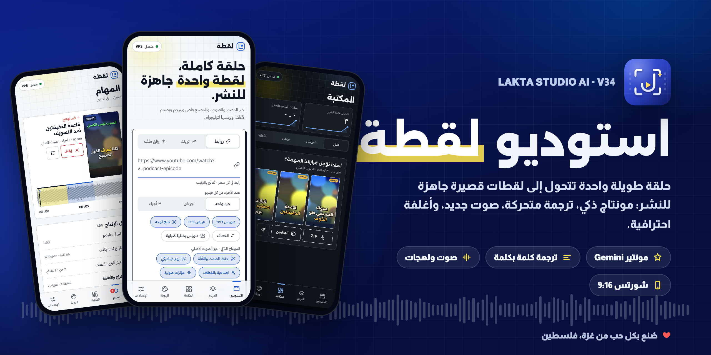
</p>

<p align="center">
  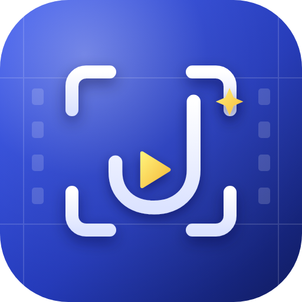
</p>

<h1 align="center">استوديو لقطة · Lakta Studio AI</h1>

<p align="center"><b>مصنع لقطات قصيرة بالذكاء الاصطناعي.</b> يحوّل الحلقات الطويلة والبودكاست إلى Shorts و Reels ومقاطع يوتيوب عريضة جاهزة للنشر، بواجهة عربية تعمل من المتصفح على Kaggle و Colab و VPS.</p>

<p align="center">
  
  
  
  
  <br>
  
  
  
</p>

<p align="center">
  <a href="#المميزات">المميزات</a> ·
  <a href="#من-داخل-الاستوديو">لقطات الشاشة</a> ·
  <a href="#التشغيل">التشغيل</a> ·
  <a href="#البنية">البنية</a> ·
  <a href="#الحقوق">الحقوق</a>
</p>

---

<table>
<tr>
<td width="62%" valign="top">

###  فكرة واحدة

ضع رابط الحلقة أو ارفع الفيديو، واختر عدد الأجزاء. يتولى لقطة الباقي:

1. تنزيل الفيديو وتفريغه كلمة بكلمة.
2. Gemini يقرأ الحلقة كاملة ويختار أقوى اللحظات.
3. مونتاج تلقائي: حذف الصمت، زوم ديناميكي، وافتتاحية صادمة.
4. ترجمة متحركة بخطك، وكلمات مفتاحية ملوّنة.
5. أغلفة احترافية وعناوين ووصف وهاشتاقات.
6. ملف مضغوط مرتب بأسماء عربية، يصلك على تيليجرام.

</td>
<td width="38%" align="center">
  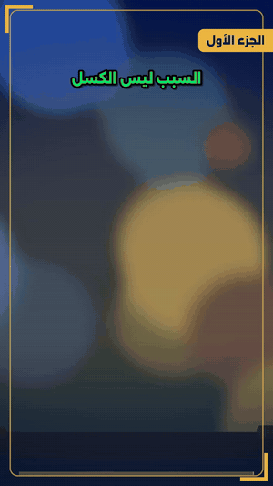<br>
  <sub>لقطة شورتس من إخراج المحرك: ترجمة كاريوكي، خطاف، قالب، وكلمات مفتاحية.</sub>
</td>
</tr>
</table>

## المميزات

<table>
<tr>
<td width="50%" valign="top">

####  مونتير ذكي (Gemini)
يقرأ التفريغ الكامل ويختار أقوى اللقطات غير المتداخلة، مع عنوان وخطاف ونص غلاف ودرجة فيروسية وكلمات مفتاحية لكل لقطة، وSEO للحلقة كاملة.

####  ترجمة كاريوكي متحركة
تفريغ دقيق وسريع بـ faster-whisper بالدفعات المتوازية. خمسة أنماط (أصفر كلاسيكي، صندوق كوبالت، قلم تظليل، توهج، كلمة كبيرة)، وحركة نبضة أو قفزة، وعبارة ذروة بخط ضخم، ومنطقة آمنة بعيدة عن أزرار المنصات، وتشكيل عربي سليم.

####  صوت جديد ولهجات
إعادة توليد الكلام بصوت معلّق (Edge مجاناً أو Gemini TTS)، حرفياً أو بإعادة صياغة، وبأي لهجة. الترجمة على الشاشة تتزامن مع الصوت الجديد.

####  ثلاثة أوضاع للصوت
الأصلي كما هو، أو صوت جديد فوق الخلفية الأصلية (فصل بـ Demucs)، أو صوت جديد مع موسيقى من مكتبتك. مع تنقية صوت المتكلم ومستوى -14 LUFS.

####  مونتاج ذكي
حذف الصمت والتأتأة، قطعات تتبع تغيّر المشهد، زوم سينمائي ناعم مع نبضة على الكلمات المفتاحية، افتتاحية بأقوى جملة مع وميض انتقال، ومؤثرات صوتية مولّدة محلياً بلا حقوق.

</td>
<td width="50%" valign="top">

####  شورتس 9:16 بتتبع الوجه
القص يتبع المتكلم (YuNet)، أو المتكلم النشط بحركة الفم، أو شاشة مقسومة لمتكلمَين، أو خلفية ضبابية تعرض الإطار العريض كاملاً.

####  هوية بصرية كاملة
مولّد قوالب بأربعة أنماط (سينمائي، شريط علوي، زوايا، ملصق)، شارة الجزء، شريط تقدم متحرك، دعوة للمتابعة، علامة مائية، و16 خطاً عربياً مع تنزيل أي خط من Google Fonts.

####  مصمم الأغلفة
ثلاثة تصاميم لكل جزء، مع اختيار أوضح إطار للوجه وتلوين أقوى كلمة.

####  جودة إخراج عالية
محرك FFmpeg مع NVENC على GPU. ثلاثة ملفات جودة، وترميز H.264 أو HEVC داخل MP4، وتلوين سينمائي، وضبط إضاءة تلقائي، وتثبيت للصورة، وتحسين للمصادر الضعيفة.

####  تسليم مرتب
ملف مضغوط باسم المشروع، فيه مجلد لكل جزء بأسماء عربية. يُرسل إلى تيليجرام، ويُقسَّم حسب الجزء إن تجاوز 50MB، مع نسخة خفيفة للفيديو الكبير.

</td>
</tr>
</table>

## من داخل الاستوديو

<p align="center"><sub>لقطات حقيقية من الواجهة أثناء التشغيل، على شاشة جوال.</sub></p>

<table>
<tr>
<td align="center" width="33%">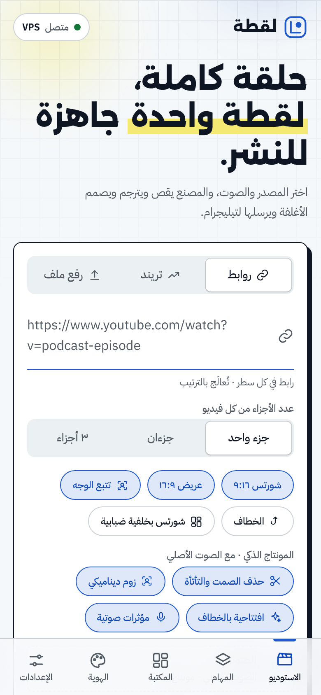<br><b>الاستوديو</b><br><sub>المصدر والأجزاء والمونتاج في شاشة واحدة</sub></td>
<td align="center" width="33%">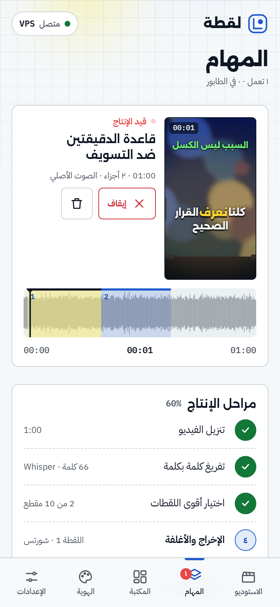<br><b>المهام</b><br><sub>تقدم حي، موجة صوت، ومراحل الإنتاج</sub></td>
<td align="center" width="33%">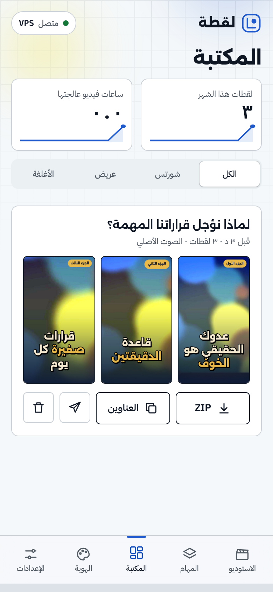<br><b>المكتبة</b><br><sub>كل اللقطات والأغلفة والملف المضغوط</sub></td>
</tr>
<tr>
<td align="center">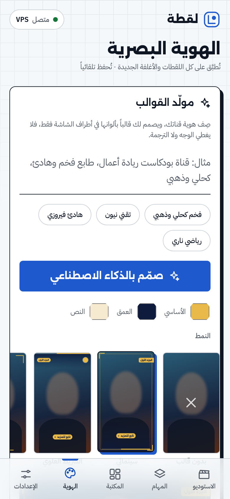<br><b>الهوية البصرية</b><br><sub>مولّد القوالب والخطوط ونمط الترجمة</sub></td>
<td align="center">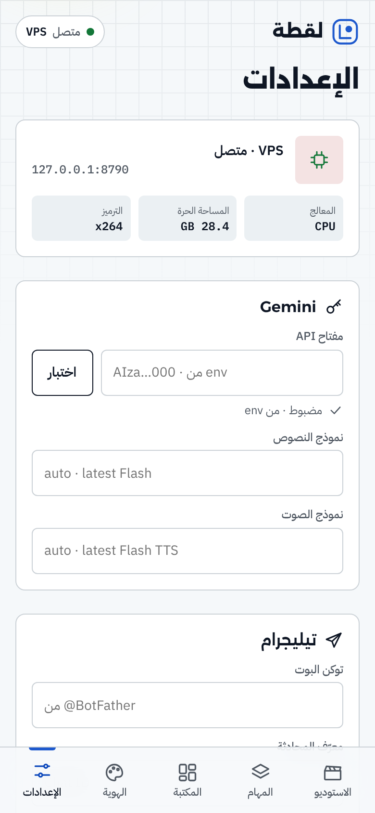<br><b>الإعدادات</b><br><sub>البيئة، Gemini، تيليجرام، والجودة</sub></td>
<td align="center">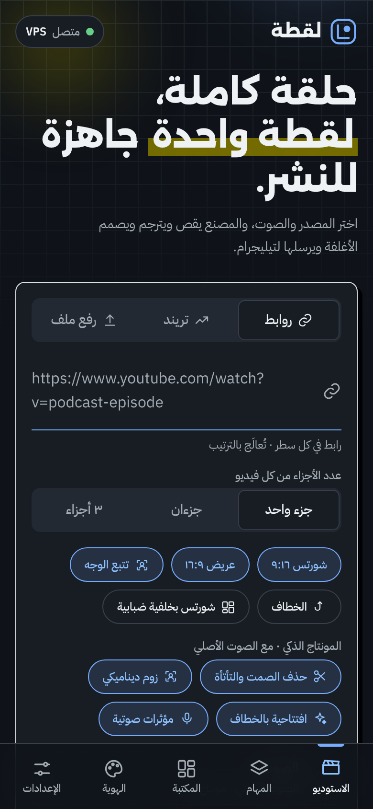<br><b>الوضع الداكن</b><br><sub>يتبع إعداد جهازك تلقائياً</sub></td>
</tr>
</table>

<p align="center">
  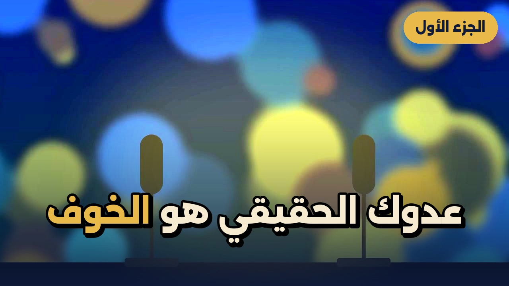
  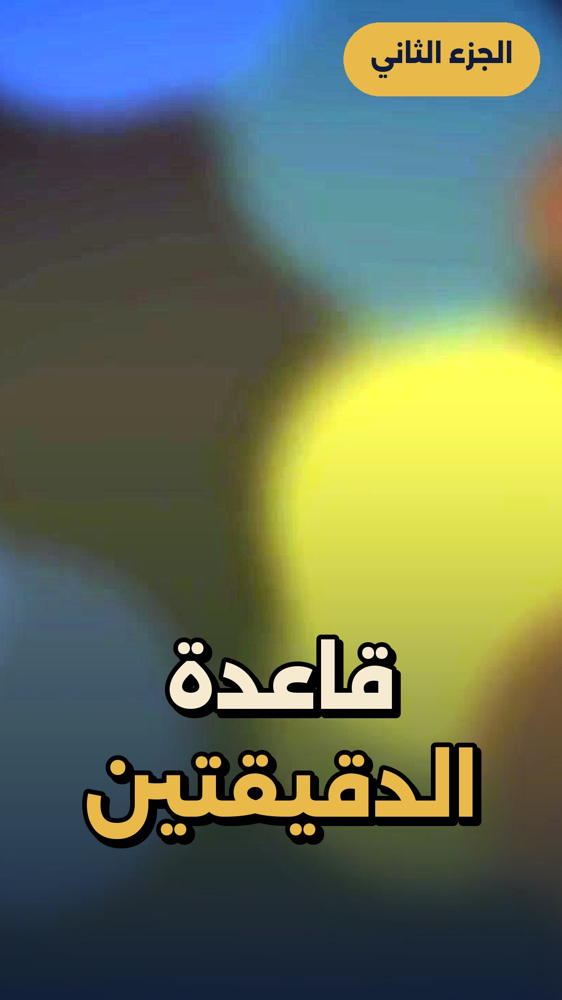
  <br><sub>أغلفة من مصمم الأغلفة: عريض وشورتس.</sub>
</p>

## التشغيل

### Kaggle (مجاني · GPU T4)
1. فعّل **Internet** و **GPU T4** من إعدادات الدفتر.
2. أضف من **Add-ons → Secrets** المفتاح `GEMINI_API_KEY`، واختيارياً `TELEGRAM_TOKEN` و `TELEGRAM_CHAT_ID`.
3. شغّل هذه الخلية:
```python
!git clone -q https://github.com/Dev-saged/Lakta-Studio-AI /kaggle/working/lakta 2>/dev/null || git -C /kaggle/working/lakta pull -q
%cd /kaggle/working/lakta
from run import main; main()
```
4. افتح الرابط الذي يظهر (`https://….trycloudflare.com/?k=…`) من أي متصفح، على الجوال أو الكمبيوتر.

### Colab
نفس الخلية مع تغيير المسار إلى `/content/lakta`. الأسرار من Secrets (أيقونة المفتاح في الشريط الجانبي) بنفس الأسماء، والملفات تُحفظ في Google Drive داخل `MyDrive/Lakta_System`.

### VPS
```bash
sudo apt install -y ffmpeg git
git clone https://github.com/Dev-saged/Lakta-Studio-AI && cd Lakta-Studio-AI
pip install -r requirements.txt
GEMINI_API_KEY=… python run.py            # مع نفق Cloudflare
python run.py --no-tunnel --port 7860      # أو على المنفذ مباشرة
```

### فحص ذاتي
`python run.py --selftest` يمرّر فيديو اصطناعياً عبر خط الإنتاج كاملاً بدون إنترنت. وفي الواجهة: الإعدادات ← فحص ذاتي.

### أسرار اختيارية
| الاسم | الاستخدام |
|---|---|
| `GEMINI_API_KEY` | المونتير الذكي، إعادة الصياغة، Gemini TTS، ومولّد القوالب |
| `TELEGRAM_TOKEN` · `TELEGRAM_CHAT_ID` | إرسال الملف المضغوط إلى تيليجرام |
| `LAKTA_PASSWORD` | رمز دخول ثابت بدل الرمز المتغير في كل تشغيل |
| `YOUTUBE_COOKIES` | تجاوز تحقق يوتيوب «Sign in to confirm you're not a bot» |

##  الأمان
- رابط الاستوديو محمي برمز دخول من 8 أرقام يظهر في خلية التشغيل، أو برمزك الثابت `LAKTA_PASSWORD`. يُقفل الدخول مؤقتاً بعد 10 محاولات خاطئة.
- من يملك الرابط الكامل مع الرمز يدخل، فلا تنشره.
- الأسرار تُقرأ من Secrets أو متغيرات البيئة، ولا تُكتب في الكود أبداً.

## 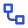 البنية
```
run.py            خلية التشغيل: المكتبات، البيئة، السيرفر، النفق
config.py         CONFIG: الهوية، النماذج، اللهجات، الأصوات، الجودة، القيم الافتراضية
lakta/
  env.py          اكتشاف Kaggle/Colab/VPS، الأسرار، الإعدادات، أدوات ffmpeg
  server.py       واجهة API، البث الحي (SSE)، الرفع، الملفات
  jobs.py         الطابور وحالة المهام وسلة المحذوفات
  pipeline.py     خط الإنتاج كاملاً
  ingest.py       yt-dlp، التريند، الملفات المرفوعة
  transcribe.py   faster-whisper وموجة الصوت
  director.py     Gemini: اختيار اللقطات، SEO، الكلمات المفتاحية، الصياغة واللهجات
  edit.py         المونتاج الذكي: الصمت، الزوم، الافتتاحية
  voice.py        Edge TTS و Gemini TTS
  audio.py        Demucs، ضبط المدة، تنقية الصوت، المزج، المؤثرات
  reframe.py      تتبع الوجه للقص 9:16
  captions.py     ترجمة ASS كاريوكي متحركة
  render.py       الإخراج بـ FFmpeg
  templates.py    مولّد القوالب
  covers.py       مصمم الأغلفة
  thumbs.py       الأغلفة البسيطة
  fonts.py        الخطوط وتنزيل Google Fonts
  package.py      الملف المضغوط بأسماء عربية
  notify.py       تيليجرام
  tunnel.py       نفق Cloudflare
  selftest.py     الفحص الذاتي
web/index.html    الواجهة كملف واحد (PWA)
assets/fonts/     خطوط عربية افتراضية (OFL)
```

##  التقنيات

<p>
  
  
  
  
  
  
  
  
</p>

---

##  المطوّر

<table>
<tr>
<td align="center" width="140">
  
</td>
<td>
  <b>ساجد العبادلة · Sajed Al-Abadlah</b><br>
  <sub>مطوّر تطبيقات تعمل دون اتصال، وأدوات أتمتة وذكاء اصطناعي عربية.</sub><br><br>
  <a href="https://github.com/Dev-saged"></a>
</td>
</tr>
</table>

## الحقوق

**© 2026 ساجد العبادلة (Sajed Al-Abadlah). جميع الحقوق محفوظة.**

استوديو لقطة، اسمه وشعاره وتصميم واجهته وكوده، ملك لمطوّره. لا يجوز نسخ المشروع أو إعادة نشره أو بيعه أو استخدامه تجارياً، كلياً أو جزئياً، دون إذن مكتوب من المطوّر.

الخطوط العربية المرفقة في `assets/fonts` مرخّصة بموجب SIL Open Font License، والتفاصيل في `assets/fonts/OFL.txt`. المكتبات المستخدمة تخضع لتراخيص أصحابها.

<br>

<p align="center">
  
  <b>صُنع بكل حب من فلسطين · غزة</b>
</p>

</div>
